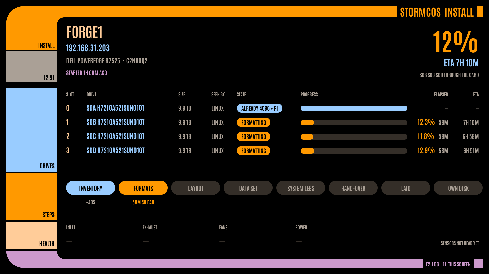
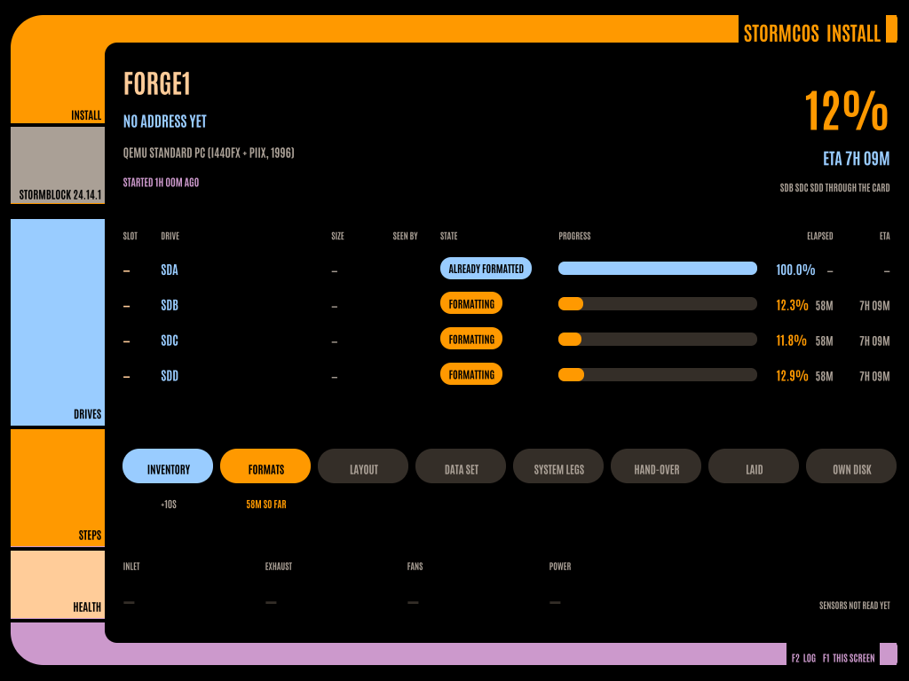

# The boot and install screen (#618)

Owner, 2026-11-15: "I really want a install screen/graphical on the install
screen showing progress. Not a log. Log can be another function key away.
Make it look professional", and "an enterprise boot screen (As in trek)".

`stormblock screen` draws the install's progress full-screen on the
machine's own display: VGA, or a BMC's virtual console. Its look is in the
spirit of a starship bridge status display, but it is our own design: a
black field, rounded elbow frames and pill bars in amber, lavender, pale
blue, peach and warm grey, condensed capitals (Antonio Bold, OFL 1.1,
bundled: `src/screen/fonts/README.md`) and large numeric readouts. Nothing
is copied and nothing is named after anyone else's.

## What it shows

It draws #616's record (`install_progress::record`, built from what `/init`
and the engine write under `/run/stormblock`), the same data as the web page
on :9090, so the two never disagree. It redraws every second.

- **Header:** STORMCOS INSTALL (or BOOT), the node's name and address, the
  machine's vendor, model and service tag (DMI), the release, and when the
  install started. On the right is the big readout: the formatting drives'
  average percent with the ETA, else the current stage, or STOPPED, or
  COMPLETE.
- **Drives:** one row per drive (up to five; more say so): slot, device and
  model, size, how it was found (`LINUX` / `CARD`), its state as a pill
  (`FORMATTING`, `FORMATTED`, `ALREADY 4096 + PI`, `LAID`, `FAILED`, `NOT
  READY`), a progress bar, percent, elapsed and ETA.
- **Steps:** inventory, formats, layout, data set, system legs, hand-over,
  laid, own disk, as pills: done (blue, with when), running (amber, with how
  long so far), pending. An ordinary boot shows only the steps it has.
- **Health:** inlet, exhaust, fans, power from the record's `health`
  (stormipmi#111); until then they read `—`.
- **The end:** a failed install turns the frames red and replaces steps and
  health with a red panel quoting the FATAL/STOP words. A finished one (laid,
  then booted) shows a blue panel with the node's name, address and the
  install record's URL. Either stays until the reboot.

## Keys, terminals and the console

The screen is on tty1 in graphics mode, so no console text is drawn over it.
**F2** gives the display back and shows tty2, where the screen writes
`/init`'s log (`init.log`) as it grows. **F1** brings the screen back. Keys
are read raw from both terminals: no key reaches a shell. The serial console
is untouched, except for one line from `/init` saying where the screen draws:
`screen: drawing on /dev/dri/card0 connector 39 crtc 37 1024x768 (1024x768)
(#618)`, or `screen: no display connected: nothing drawn`.

## When it runs

`/init` starts it once the command line is read, on every boot, and it opens
the first DRM card with a connected display. On hardware that is `simpledrm`
over the firmware's framebuffer (the UEFI GOP), with no driver needed.
Headless, it says so and exits. At switch_root it stops and gives the
display back on an ordinary boot; on an install boot it goes on to the
finished or failure panel. `rd.stormblock.screen=off` runs none.

The layout is drawn on 1920 × 1080 and stretched to the display across and
down apart, so a 4:3 or 5:4 BMC console is filled. Type and corners take the
smaller scale.

## Checked

- `cargo test --lib screen::` covers the canvas shapes and text, the DRM
  structs at the kernel's sizes and ioctl numbers, the keys and the log
  follower, and the screen as pictures: forge1's four drives formatting, the
  failure panel, the finished panel at 1280 × 720, an ordinary boot at
  1024 × 768. With `STORMBLOCK_SCREEN_SNAPSHOTS=<dir>` each is written as a
  PNG. `stormblock screen --snapshot out.png` draws the current record.
- `ci-screen-verify.sh` (`sc-build 'bash ci-screen-verify.sh'`) boots the
  build host's kernel in QEMU with a linear framebuffer (`vga=0x318`, so
  simpledrm binds), runs the screen over a sample install, and reads the
  display back with QEMU's `screendump`. It checks that the frame is drawn,
  that F2 shows the log (no frame colours, text) and that F1 brings the
  screen back.

## Not yet

- After switch_root on an ordinary boot, the screen stops. stormpump's
  stages drawn on the same screen are stormpump#237.
- A GPU driver that replaces simpledrm after switch_root (mgag200 on an
  iDRAC) takes the display from it.
- The stormbootx panel's look (its own issue), and the health values
  (stormipmi#111).
